<div align="center">


# BuscaMangá Extension

**Repositório Comunitário de Extensões em Português (PT-BR) para Paperback v0.9+**

Coleção otimizada de fontes para leitura de mangás, manhwas, manhuas e quadrinhos nacionais diretamente no aplicativo Paperback.

[](https://paperback.moe/)
[](#-fontes-disponíveis)
[](https://www.typescriptlang.org/)
[](LICENSE)
[](https://matheusparnaiba.github.io/buscamanga-extension/)

<br />

[📲 Adicionar ao Paperback](paperback://addRepo?displayName=BuscaManga&url=https%3A%2F%2Fmatheusparnaiba.github.io%2Fbuscamanga-extension%2F0.9%2Fstable%2F) • [🌐 Catálogo Web](https://matheusparnaiba.github.io/buscamanga-extension/0.9/stable/) • [🏠 Página do Repositório](https://matheusparnaiba.github.io/buscamanga-extension/)

</div>

---

## 📌 Visão Geral

O **BuscaMangá Extension** é um repositório desenvolvido para suprir a demanda da comunidade brasileira de leitores de mangá no **[Paperback](https://paperback.moe/)** (iOS / iPadOS). O ecossistema reúne as principais fontes e scans do país, trazendo alta fidelidade visual, metadados enriquecidos, páginas em alta definição e mecanismos nativos para contornar desafios de rede (Cloudflare / WAF).

> 💡 **Compatibilidade:** Desenvolvido exclusivamente para o **Paperback v0.9+** utilizando `@paperback/toolchain` e `@paperback/types`.

---

## 📦 Fontes Disponíveis

Todas as 62 extensões estão catalogadas e sincronizadas no GitHub Pages:

|                                            Ícone                                            | Nome                   |  Versão  | Site Oficial                                                         | Categoria / Recurso                     |   Status    |
| :-----------------------------------------------------------------------------------------: | :--------------------- | :------: | :------------------------------------------------------------------- | :-------------------------------------- | :---------: |
|           | **Acervo Hentai**      | `1.0.0`  | [acervohentai.com](https://acervohentai.com)                         | Pornhwa & Manhwa Adulto • +18           |  🟢 Ativo   |
|            | **Apenas Uma Fã**      | `1.0.0`  | [apenasuma-fa.blogspot.com](https://apenasuma-fa.blogspot.com)       | Obras Independentes                     |  🟢 Ativo   |
|               | **Arthur Scan**        | `1.0.5`  | [arthurscan.xyz](https://arthurscan.xyz)                             | Ação & Cultivação                       |  🟢 Ativo   |
|                | **AstraToons**         | `1.0.0`  | [new.astratoons.com](https://new.astratoons.com)                     | Webtoons & Mangás                       |  🟢 Ativo   |
|        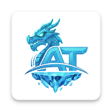        | **Azuretoons**         | `1.0.0`  | [azuretoons.com](https://azuretoons.com)                             | Manhwas & Ação                          |  🟢 Ativo   |
|   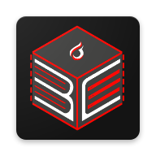    | **Blackout Comics**    | `1.0.1`  | [blackoutcomics.com](https://blackoutcomics.com)                     | Comics Adultos • +18                    |  🟢 Ativo   |
|   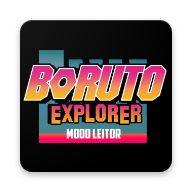    | **Boruto Explorer**    | `1.0.3`  | [leitor.borutoexplorer.com.br](https://leitor.borutoexplorer.com.br) | Naruto & Boruto                         |  🟢 Ativo   |
|           | **Brasil Hentai**      | `1.0.1`  | [brasilhentai.com](https://brasilhentai.com)                         | Doujinshis & Mangás • +18               |  🟢 Ativo   |
|           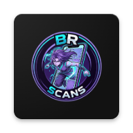           | **BRScans**            | `1.0.0`  | [brscans.vercel.app](https://brscans.vercel.app)                     | Leitor Ágil na Vercel                   |  🟢 Ativo   |
|                  | **Capitoons**          | `1.0.0`  | [capitoons.com](https://capitoons.com)                               | Webtoons & Manhwas                      |  🟢 Ativo   |
|        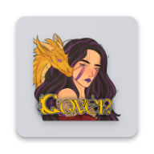         | **Coven Scan**         | `1.0.0`  | [covendasbruxonas.com](https://covendasbruxonas.com)                 | Manhwas Adultos • +18                   |  🟢 Ativo   |
|                   | **Ego Toons**          | `1.0.0`  | [egotoons.com](https://egotoons.com)                                 | Manhwas & Webtoons (API)                |  🟢 Ativo   |
|                      | **Fliptru**            | `1.0.3`  | [fliptru.com.br](https://fliptru.com.br)                             | Quadrinhos Nacionais Independentes      |  🟢 Ativo   |
|            | **Flower Mangas**      | `1.0.0`  | [flowermangas.net](https://flowermangas.net)                         | Mangás & Manhwas                        |  🟢 Ativo   |
|               | **GALAX Scans**        | `1.0.0`  | [galaxscanlator.blogspot.com](https://galaxscanlator.blogspot.com)   | Shonen & Fantasia                       |  🟢 Ativo   |
|      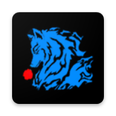       | **Geass Comics**       | `1.0.0`  | [geasscomics.xyz](https://geasscomics.xyz)                           | Manhwas & Shonen                        |  🟢 Ativo   |
|           | **Hanmokku Scan**      | `1.0.0`  | [hanmokkuscan.blogspot.com](https://hanmokkuscan.blogspot.com)       | Mangás Shonen                           |  🟢 Ativo   |
|                   | **Hentai HQ**          | `1.0.5`  | [hentaihq.net](https://hentaihq.net)                                 | HQs de Sexo • +18                       |  🟢 Ativo   |
|           | **Hentai Season**      | `1.0.0`  | [hentaiseason.com](https://hentaiseason.com)                         | Doujinshis & Packs • +18                |  🟢 Ativo   |
|             | **Hentai Tokyo**       | `1.0.0`  | [hentaitokyo.net](https://hentaitokyo.net)                           | Quadrinhos Eróticos • +18               |  🟢 Ativo   |
|                  | **HipercooL**          | `1.0.0`  | [lerhentais.com](https://lerhentais.com)                             | Adulto, Pornhwa & Doujinshi • +18       |  🟢 Ativo   |
|                  | **Hipertoon**          | `1.0.18` | [hipertoon.com](https://hipertoon.com)                               | Manhwas • `Bypass Cloudflare` 🛡️        |  🟢 Ativo   |
|       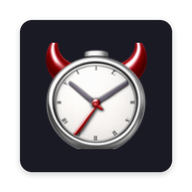        | **Hora Hentai**        | `1.0.0`  | [horahentai.com](https://horahentai.com)                             | Mangás Hentai • +18                     |  🟢 Ativo   |
|                   | **HQ Hentai**          | `1.0.6`  | [hqhentai.online](https://hqhentai.online)                           | HQs & Doujinshi • +18                   |  🟢 Ativo   |
|                         | **HQ Now**             | `1.0.3`  | [hq-now.com](https://www.hq-now.com)                                 | Quadrinhos Ocidentais & HQs             |  🟢 Ativo   |
|                     | **HQ Porno**           | `1.0.4`  | [hqporno.net](https://www.hqporno.net)                               | Quadrinhos Eróticos • +18               |  🟢 Ativo   |
|  | **Kami Sama Explorer** | `1.0.3`  | [leitor.kamisama.com.br](https://leitor.kamisama.com.br)             | Dragon Ball & Shonen                    |  🟢 Ativo   |
|               | **Kuro Mangás**        | `1.0.0`  | [kuromangas.com](https://kuromangas.com)                             | Catálogo Geral • API                    |  🟢 Ativo   |
|           | **Leitura Manga**      | `1.0.3`  | [leituramanga.net](https://leituramanga.net)                         | Mangás & Manhuas                        |  🟢 Ativo   |
|           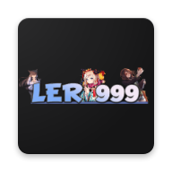            | **Ler 999**            | `1.0.0`  | [ler999.blogspot.com](https://ler999.blogspot.com)                   | Comics Ocidentais                       |  🟢 Ativo   |
|         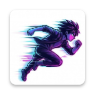         | **MangaDash**          | `1.0.0`  | [mangadash.net](https://mangadash.net)                               | Mangás & Agregador Ágil                 |  🟢 Ativo   |
|                    | **MangaDex**           | `1.0.0`  | [mangadex.org](https://mangadex.org)                                 | Catálogo Global • `API Oficial v5` 🌐   |  🟢 Ativo   |
|                 | **Manga Flix**         | `1.0.2`  | [mangaflix.net](https://mangaflix.net)                               | Mangás & Manhwas                        |  🟢 Ativo   |
|       | **MangaLivre Blog**    | `1.0.14` | [mangalivre.blog](https://mangalivre.blog)                           | Mangás Diversos                         |  🟢 Ativo   |
|           | **MangaLivre To**      | `1.0.5`  | [mangalivre.to](https://mangalivre.to)                               | Mangás Populares                        | 🟡 Instável |
|                    | **MangaNYX**           | `1.0.14` | [manganyx.com](https://manganyx.com)                                 | Catálogo Geral • `Bypass Cloudflare` 🛡️ |  🟢 Ativo   |
|             | **Manga Online**       | `1.0.20` | [mangaonline.love](https://mangaonline.love)                         | Mangás & Manhwas                        |  🟢 Ativo   |
|         | **Mangás Brasuka**     | `1.0.18` | [mangasbrasuka.com.br](https://mangasbrasuka.com.br)                 | Mangás & Scans • `Bypass Cloudflare` 🛡️ |  🟢 Ativo   |
|                  | **Manhastro**          | `1.0.3`  | [manhastro.net](https://manhastro.net)                               | Manhwas & Ação                          |  🟢 Ativo   |
|                   | **Monte Tai**          | `1.0.0`  | [montetaiscanlator.xyz](https://montetaiscanlator.xyz)               | Cultivação & Manhuas                    |  🟢 Ativo   |
|   | **Mugiwaras Oficial**  | `1.0.0`  | [mugiwarasoficial.org](https://mugiwarasoficial.org)                 | Shonen & Ação                           |  🟢 Ativo   |
|             | **Muito Hentai**       | `1.0.6`  | [muitohentai.com](https://www.muitohentai.com)                       | Hentai Mangá • +18                      |  🟢 Ativo   |
|             | **Mundo Hentai**       | `1.0.5`  | [mundohentaioficial.com](https://mundohentaioficial.com)             | Hentai & Doujinshi • +18                |  🟢 Ativo   |
|           | **Nebulosa Scan**      | `1.0.5`  | [nebulosascan.com](https://nebulosascan.com)                         | Scans Exclusivas                        |  🟢 Ativo   |
|      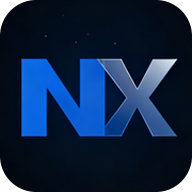       | **Nexus Mangás**       | `1.0.0`  | [nexusmangas.com](https://www.nexusmangas.com)                       | Manhwas & Mangás • Supabase             |  🟢 Ativo   |
|                 | **NHentai BR**         | `1.0.5`  | [nhentaibr.com](https://nhentaibr.com)                               | Hentai & Doujinshi • +18                |  🟢 Ativo   |
|                 | **Ninja Scan**         | `1.0.4`  | [ninjacomics.xyz](https://ninjacomics.xyz)                           | Manhwas & Fantasia                      | 🟡 Instável |
|                  | **OneReader**          | `1.0.0`  | [onereader.net](https://onereader.net)                               | Leitor Diário de Mangás                 |  🟢 Ativo   |
|           | **Pizzaria Scan**      | `1.0.0`  | [pizzariacomics.com](https://pizzariacomics.com)                     | Mangás & Webtoons                       |  🟢 Ativo   |
|      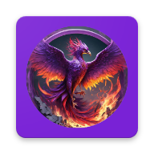       | **Pluma Comics**       | `1.0.0`  | [plumacomics.cloud](https://plumacomics.cloud)                       | Manhuas & Cultivação                    |  🟢 Ativo   |
|     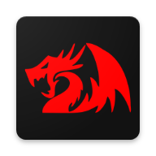     | **RF Dragon Scan**     | `1.0.0`  | [rfdragonscan.net](https://rfdragonscan.net)                         | Manhwas de Ação & Fantasia              |  🟢 Ativo   |
|                      | **Roxinha**            | `1.0.0`  | [roxinha.online](https://roxinha.online)                             | Agregador de Mangás                     |  🟢 Ativo   |
|             | **Taimu Mangás**       | `1.0.0`  | [beta.taimumangas.com](https://beta.taimumangas.com)                 | Plataforma Moderna de Mangás            |  🟢 Ativo   |
|                          | **Taiyō**              | `1.0.0`  | [taiyo.moe](https://taiyo.moe)                                       | Plataforma Comunitária (Meilisearch)    |  🟢 Ativo   |
|           | **Tankou Hentai**      | `1.0.0`  | [tankouhentai.com](https://tankouhentai.com)                         | Tankoubon & Hentai • +18                |  🟢 Ativo   |
|                     | **Tao Sect**           | `1.0.3`  | [taosect.com](https://taosect.com)                                   | Artes Marciais & Seinen                 |  🟢 Ativo   |
|                        | **ToonBr**             | `1.0.0`  | [beta.toonbr.com](https://beta.toonbr.com)                           | Leitura Digital de Quadrinhos           |  🟢 Ativo   |
|    | **Traduções do Lipe**  | `1.0.0`  | [traducoesdolipe.blogspot.com](https://traducoesdolipe.blogspot.com) | Mangás Clássicos & Retrô                |  🟢 Ativo   |
|                  | **Vegitoons**          | `1.0.0`  | [vegitoons.black](https://vegitoons.black)                           | Manhwas & Webtoons                      |  🟢 Ativo   |
|               | **Yomu Comics**        | `1.0.0`  | [yomu.com.br](https://yomu.com.br)                                   | Mangás, Manhwas & Novels                |  🟢 Ativo   |
|        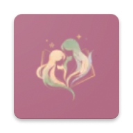        | **Yuri on Air**        | `1.0.4`  | [yurionair.top](https://yurionair.top)                               | Yuri & Shoujo Ai                        |  🟢 Ativo   |
|                      | **ZettaHQ**            | `1.0.0`  | [zettahq.com](https://zettahq.com)                                   | Hentai 3D & Comics • +18                |  🟢 Ativo   |

> ℹ️ _Sites protegidos por Cloudflare utilizam rotinas de bypass compatíveis com o ambiente de execução do Paperback._
>
> ⚠️ _Fontes marcadas como **Instável** podem apresentar instabilidade temporária devido a oscilações no servidor de hospedagem original._

---

## 🚀 Como Instalar no Paperback

### Método 1: Adição Rápida (1 Clique)

Se você estiver visualizando esta página pelo Safari no seu dispositivo iOS / iPadOS com o Paperback instalado:

- Toque no link direto: **[Adicionar Repositório BuscaMangá ao Paperback](paperback://addRepo?displayName=BuscaManga&url=https%3A%2F%2Fmatheusparnaiba.github.io%2Fbuscamanga-extension%2F0.9%2Fstable%2F)**

### Método 2: Instalação Manual

1. Copie o URL estável do repositório:
   ```text
   https://matheusparnaiba.github.io/buscamanga-extension/0.9/stable/
   ```
2. Abra o aplicativo **Paperback**.
3. Navegue até a aba **Settings** (Configurações) > **External Repositories** (Repositórios Externos).
4. Toque no ícone **`+`** no canto superior e cole a URL copiada.
5. Confirme e acesse a aba **Extensions** (Extensões) para instalar as fontes de sua preferência.

---

## ✨ Recursos e Destaques

- 🛡️ **Bypass Nativo de Proteções:** Fontes que empregam proteções WAF e Cloudflare contam com interceptadores configurados para transmissão contínua de páginas e miniaturas sem erros de bloqueio.
- 🔍 **Busca Completa & Filtros:** Localize qualquer mangá ou gênero diretamente pela busca universal do leitor.
- 🖼️ **Seções de Destaque:** Carrosséis na tela inicial organizados por lançamentos recentes, mais populares e atualizações do dia.
- 📖 **Leitura Fluida:** Extração precisa de capítulos e imagens em alta resolução, com referers e cabeçalhos corretos para evitar quebras de CDN.
- 🇧🇷 **Foco Total em PT-BR:** Todas as extensões catalogadas fornecem obras traduzidas para o português do Brasil.

---

## 💻 Desenvolvimento Local

Este projeto utiliza **TypeScript**, **Node.js** e a CLI oficial do Paperback.

### Pré-requisitos

- [Node.js](https://nodejs.org/) v20+
- Gerenciador de pacotes `npm`

### Instalação & Comandos

1. **Clone o repositório:**

   ```bash
   git clone https://github.com/matheusparnaiba/buscamanga-extension.git
   cd buscamanga-extension
   ```

2. **Instale as dependências:**

   ```bash
   npm install
   ```

3. **Verificação de Conformidade (TypeScript, Lint e Formatação):**

   ```bash
   npm run conformance
   ```

4. **Compilar os Bundles de Produção:**

   ```bash
   npm run bundle
   ```

   _Os arquivos compilados são gerados na pasta `./bundles`._

5. **Servidor Local de Testes (Dev Server):**
   ```bash
   npm run dev
   ```

---

## 📁 Estrutura do Repositório

```text
buscamanga-extension/
├── .github/workflows/    # Pipelines de CI/CD para validação e deploy no Pages
├── assets/               # Identidade visual, logotipos e ícones das fontes
├── bundles/              # Pacotes compilados das extensões e versioning.json
├── src/                  # Código-fonte TypeScript de cada extensão
│   ├── ArthurScan/
│   ├── BorutoExplorer/
│   ├── Fliptru/
│   ├── HentaiHQ/
│   ├── Hipertoon/
│   ├── HQHentai/
│   ├── HQNow/
│   ├── HQPorno/
│   ├── KamiSamaExplorer/
│   ├── LeituraManga/
│   ├── MangaFlix/
│   ├── MangaLivreBlog/
│   ├── MangaLivreTo/
│   ├── MangaNYX/
│   ├── MangaOnline/
│   ├── MangasBrasuka/
│   ├── Manhastro/
│   ├── MuitoHentai/
│   ├── MundoHentai/
│   ├── NebulosaScan/
│   ├── NHentaiBR/
│   ├── NinjaScan/
│   ├── TaoSect/
│   └── YuriOnAir/
├── root-index.html       # Landing page do repositório no GitHub Pages
├── template.html         # Template do catálogo web dinâmico (0.9/stable)
└── README.md             # Documentação oficial do projeto
```

---

## 📄 Licença e Aviso Legal

- **Aviso Legal:** Este projeto é open-source e tem fins estritamente educacionais e de interoperabilidade. O repositório e suas extensões não hospedam, armazenam ou redistribuem nenhum conteúdo protegido por direitos autorais; apenas conectam o aplicativo Paperback a websites públicos já disponíveis na internet.
- **Licença:** Distribuído sob a licença [GNU General Public License v3.0](LICENSE).
